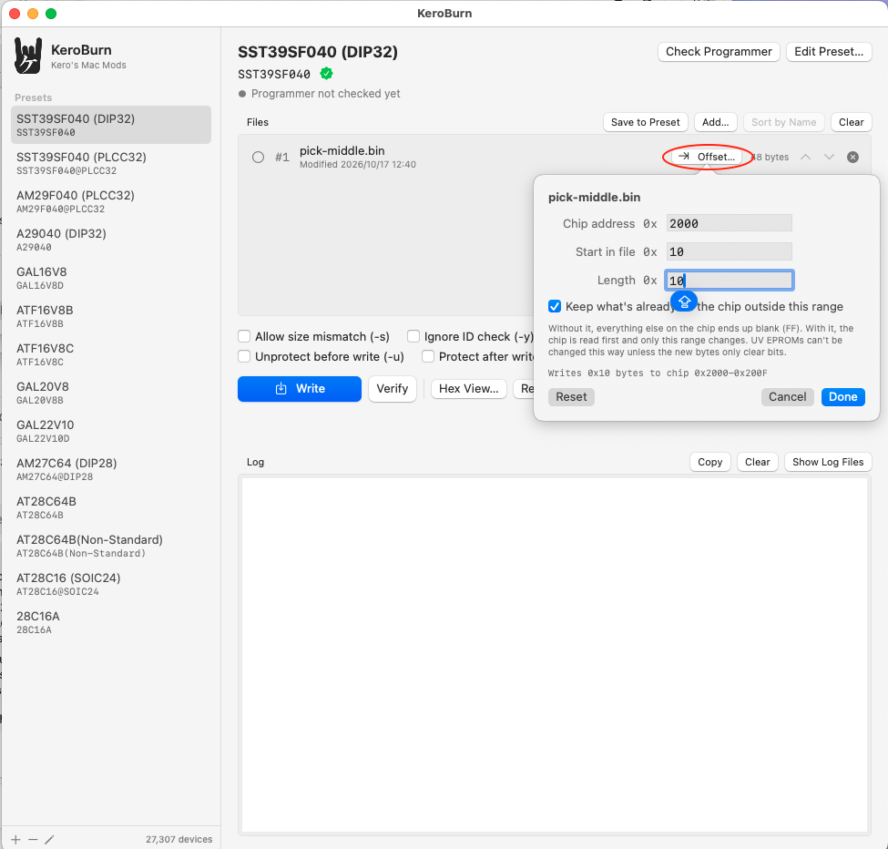
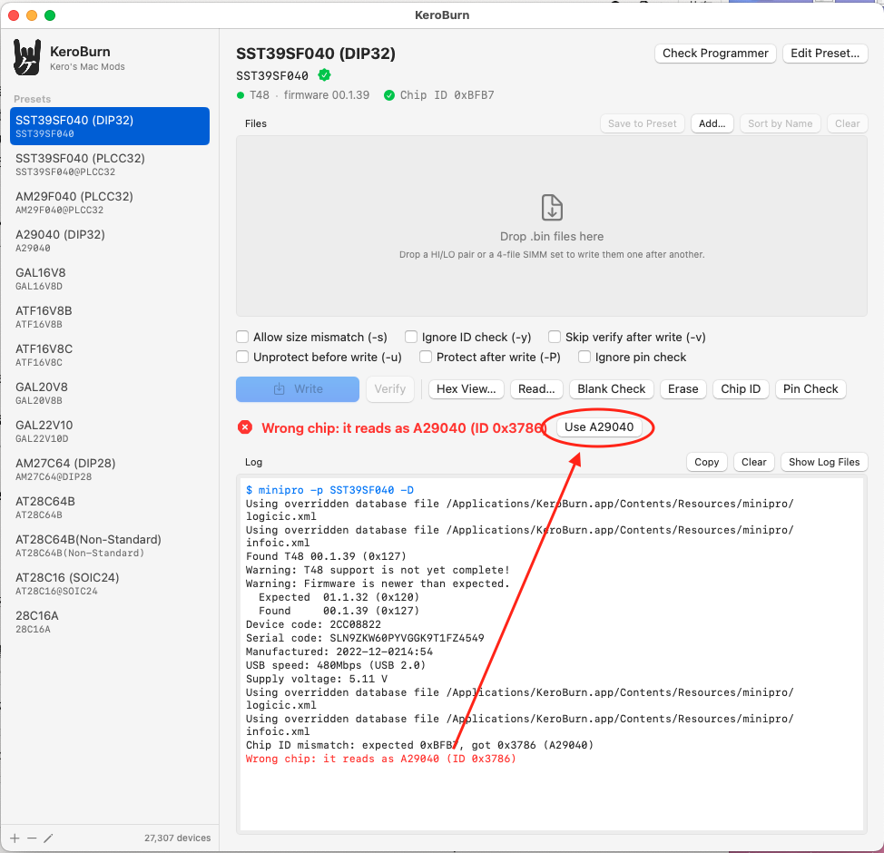
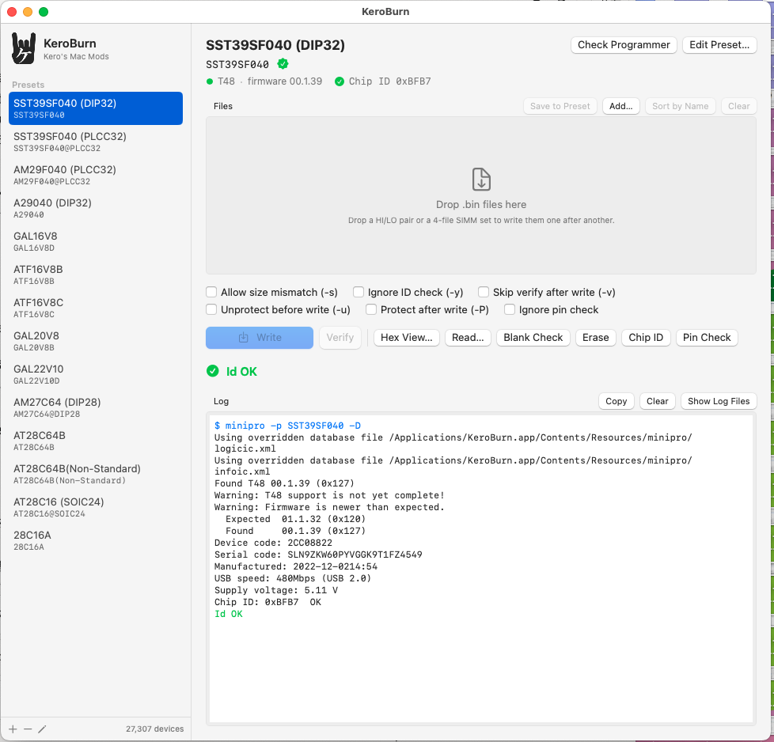
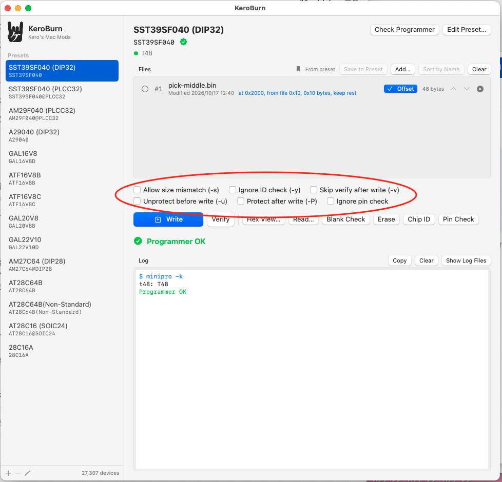
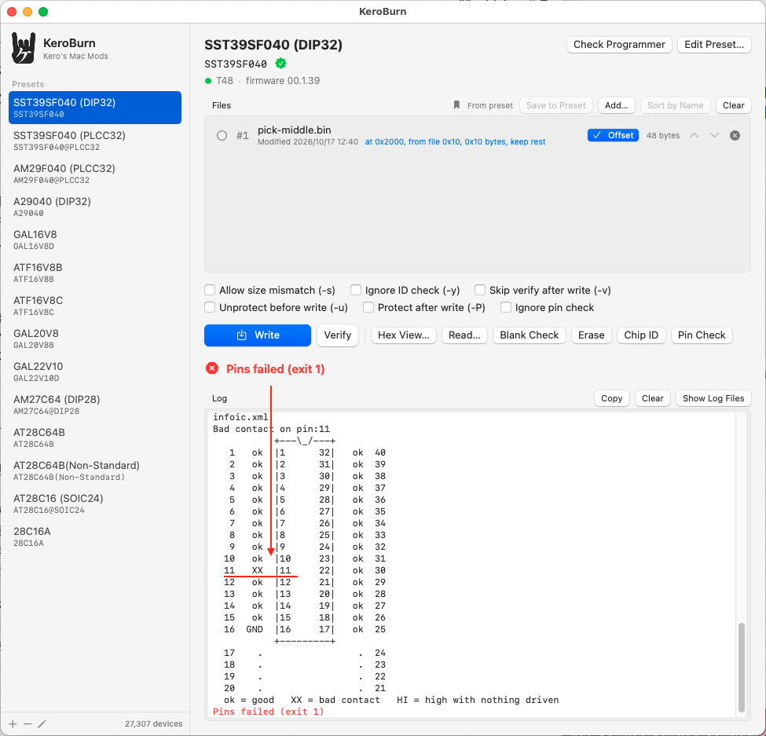
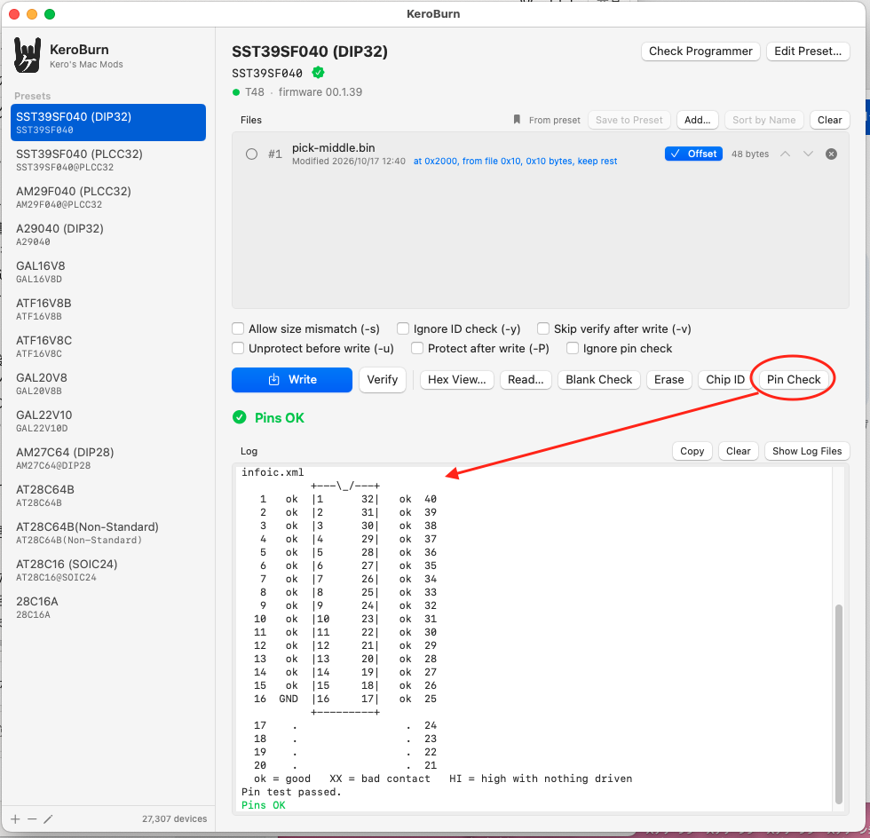
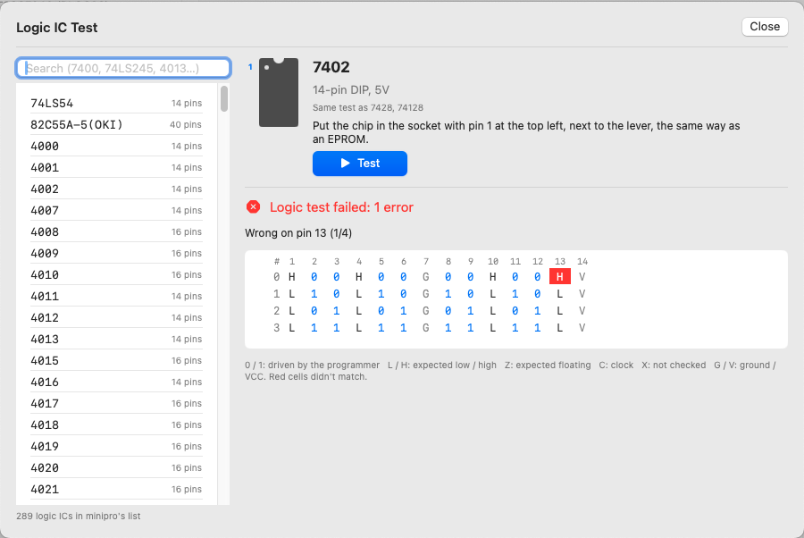

# KeroBurn

A Mac front end for [minipro](https://gitlab.com/DavidGriffith/minipro), the open source driver for XGecu chip programmers (T48, T56, TL866II+, TL866A/CS). Pick a chip, drop a file on the window, hit Write. No Windows box, no typing device names into Terminal.

I wrote it because I flash the same handful of parts over and over (SST39SF040, AM29F040, AT28C64B, GAL16V8/20V8/22V10) and got tired of looking up the exact minipro spelling every time.


minipro, libusb and the device database are bundled inside the app, so you don't need Homebrew or MacPorts to run it. Universal binary, runs natively on Intel and Apple Silicon. macOS 12 or later.

## Install

Open `KeroBurn-1.0.dmg` and drag KeroBurn into Applications.

The app is only ad hoc signed, not notarized, so macOS will refuse to open it the first time. How you get past that depends on your macOS version:

- **macOS 14 Sonoma and older:** right-click the app, choose Open, then Open again in the dialog.
- **macOS 15 Sequoia and newer:** right-click doesn't work any more. Try to open the app once, then go to System Settings → Privacy & Security, scroll down to the bottom and click "Open Anyway" next to the KeroBurn message.

After that it opens normally.

## Using it

1. Pick a preset on the left.
2. Drop a `.bin` (or `.jed` for GALs) on the Files area.
3. Write (⌘↩).

Drop more than one file and they get written in order, one chip each. After every chip a yellow bar asks you to swap in the next one, press Return to continue. That's how I do ROM HI/LO pairs and 4-chip ROM SIMM sets. Files sort by name when you drop them, so `_HI` comes before `_LO` and `_0` before `_3`. Use the arrows if you want a different order.


Under the preset name you'll see which programmer is connected and its firmware, plus the chip ID once it's been checked. That's there on purpose, so a screenshot posted when asking for help already says what hardware it's on.

## Writing at an address (Offset…)

Every file in the list has an **Offset…** button. It's the same idea as the file load dialog in Xgpro:




- **Chip address**: where on the chip the file goes
- **Start in file** and **Length**: use only part of the file (leave them empty for the whole file)
- **Keep what's already on the chip**: the chip is read first and only that range changes

So if you only want to change a few bytes of code in a ROM, put the patch in its own small file, give it the address, tick Keep, and write. Without Keep, everything outside the range ends up blank (FF).

Flash chips like the 39SF040 can only be erased as a whole, so with Keep the chip is read, the range is swapped in, then it's erased and written back in full. Verify only checks the range you placed. UV EPROMs can't be erased by the programmer, so on those it only works if the new bytes just clear bits, and KeroBurn stops before writing if they don't.

Hex View knows about the offset too, so comparing the file against the chip lines up.

This needs options minipro doesn't have yet. They come from a patch in this repo (`patches/keroburn-place-at-offset.patch`), and the bundled minipro is built with it. From Terminal:

```
minipro -p SST39SF040 -w patch.bin --offset 0x1000 --keep
minipro -p SST39SF040 -m patch.bin --offset 0x1000
```

`--file_offset` and `--length` pick part of the file.

## Hex View


This is the part I use most. Hex View loads the file, reads the chip in the socket, and puts them side by side with every byte that doesn't match in red. Use the Diff arrows to jump between mismatches, or tick "Only rows with differences".

It also tries to tell you what went wrong:

- if the file's data turns up in the chip at a different address, it reports the shift (handy when an image was built for the wrong base address)
- if every mismatch is on even or odd addresses only, it says so, because that's usually a HI/LO mix-up
- if the chip reads back as all FF, it says the chip looks blank

Sum and CRC32 are shown for both the file and the chip. Nothing is editable yet, it's a viewer.

Read… on the main screen opens Hex View and reads the chip straight away. Nothing is saved unless you press Save Chip…. GALs and other PLDs still go straight to a .jed file, since they don't show as hex. For GALs it shows the .jed as text, so a file vs chip compare there will flag header differences too. Use Verify for PLDs.

The other buttons are straight minipro options:

| Button | minipro |
|---|---|
| Verify | `-m` |
| Read… | `-r` (into Hex View) |
| Blank Check | `-b` |
| Erase | `-E` |
| Chip ID | `-D` (see below) |
| Pin Check | `-z` |
| Check Programmer | `-k` |

**Chip ID** also tells you what the chip really is when it doesn't match. With an AM29F040 preset and an SST39SF040 in the socket, you get "Wrong chip: it reads as SST39SF040" and a button to switch to that preset (or make one). Handy for parts with a sticker over the number.



When the ID matches you get "Id OK", and the confirmed ID shows next to the programmer at the top:



 Pick any preset from the same family first, since the ID is read differently for flash, EPROMs and so on. It only works for chips minipro has an ID for. Many older EPROMs, GALs and the AT28C16 don't have one, and KeroBurn just says so.

The checkboxes are saved per preset:




- Allow size mismatch (`-s`)
- Ignore ID check (`-y`)
- Skip verify after write (`-v`)
- Unprotect before write (`-u`), for EEPROMs with software data protection
- Protect after write (`-P`)
- Ignore pin check (skips the contact test below)

While a job runs, the status bar shows the current step (checking pins, checking ID, erasing, writing, reading, verifying), a progress bar and how long the step has taken. minipro gives no percentage while erasing, so the bar just keeps moving there.

## Pin contact test

Before every write KeroBurn runs a pin contact test, the same idea as the red X's in Xgpro's "Location in Socket" picture. If a leg isn't touching, the write stops and the log draws the socket with an XX on that pin. Here pin 11 was lifted on purpose:



Press Pin Check to run the test on its own. With every leg seated it ends in "Pins OK":



minipro 0.7.4 only has a pin test for the TL866II+, so KeroBurn ships its own for the T48 as a patch (`patches/keroburn-t48-pin-test.patch`). The same patch adds the socket drawing to the TL866II+ test too. It puts about 3.3V on the chip's GND pin with every other pin pulled down. Each leg that really touches the socket gets pulled up through the chip's own protection diode and reads high. A leg that doesn't stays low.

A few limits:

- The GND pin itself can't be tested this way, but if it isn't touching, every other pin fails too, so you'll still notice.
- Chips with GND on ZIF pin 17 to 24 (most 40-pin parts) are skipped, the T48 can't drive those pins.
- I've tested it on 32-pin flash so far. Other packages should work the same way, but tell me if they don't.

## Split, Undo Split and Join

**Split / Join…** next to Add… opens a window with three tabs.

**Split** turns one ROM file into a file per chip, for boards that read 2 chips as 16 bits (Mac Plus, SE, Classic) or 4 chips as 32 bits (SE/30, IIx, IIci and the other ROM SIMM Macs). Byte order is big-endian like on 68K Macs: HI gets the even bytes, and with 4 chips HH gets byte 0 of every long word. The parts come out as `name_HI.bin` and `name_LO.bin`, or `name_1-LL.bin` to `name_4-HH.bin`.

Chip size starts at the size of the chip in the current preset. If a part is smaller than the chip, it's repeated to fill it (×2, ×4, ×8 and so on), so it doesn't matter which way the board ties the unused upper address lines. The 128 KB HI half of an SE ROM on a 512 KB SST39SF040 gets written four times, for example. **1 chip (no split)** only does the filling, for a small ROM on a bigger chip. Tick "Put them in the file list" and the parts land in the file list, ready to write.

**Undo Split** puts the parts back together into the entire ROM. Drop all 2 or 4 files on it at once and it matches them up by HI, LO, LL, ML, MH or HH in the name (or by name order). Each part can also come straight from a chip with Read Chip. Repeated copies from a bigger chip are dropped, so you get the original size back. If the result is a 68K Mac ROM, the checksum in its header gets checked and you see "Mac ROM checksum OK".

**Join** stacks files one after another, like a ROM followed by a disk image. Each file starts where the one before it ends, and the list shows the address range of each. "Fill the end to" pads the rest with FF up to the chip size.

## Logic IC test

**Logic Test…** at the top right tests 74 and 4000 series chips, about 290 of them, with the test vectors that come with minipro. Pick the chip, put it in the socket with pin 1 at the top left next to the lever, and press Test. Every vector runs once with pull-ups and once with pull-downs, so an output that's stuck or not connected at all gets caught too.

When something's wrong, the window says which pins failed and in how many vectors, and the table marks every cell that didn't match in red. Here I bent pin 13 of a 7402 so it barely touched the socket:



Only chips in minipro's list can be tested, and they all run at 5V. There's no "guess what this chip is" mode on purpose. Driving the wrong pins of an unknown chip can damage it.

## Presets

Add one with the + button, or right-click an existing one and Duplicate. In the editor, type part of a name like `2732` or `2764` and pick from the list (the up and down arrows work too). You can give a preset an emoji icon so it's easier to spot in the sidebar. The list comes from the T48 / TL866II+ section of minipro's database, so a name with a green check is one your programmer will accept. An orange triangle means minipro doesn't know that name.

Watch out, some parts are named differently for the T48 than for the old TL866A. A29040 in PLCC32 is `A29040L@PLCC32` on the T48, for example.


Presets can also remember their files. Line them up (with offsets if you want), press **Save to Preset**, and next time you pick that preset they're already there. Handy for things you flash over and over, like a ROM HI/LO pair. If a saved file has been moved or renamed it shows in orange and the write won't start. Each file also shows when it was last modified, so you notice if a ROM image changed under you.

While the app is open, every preset keeps its own file list, saved or not, so switching back and forth doesn't lose anything.

Presets live in `~/Library/Application Support/KeroBurn/presets.json`. You can edit it by hand and reload it from Settings.

## Logs

Every job gets one line in `~/Library/Logs/KeroBurn/KeroBurn-YYYY-MM.log`: time, preset, file name, size and the first 16 hex digits of the file's SHA-256. Failures also get the last few lines of minipro output. I use it to check which ROM image went into which order.

## Known issues

**AT28C64B fails verify at address 0x0001.** Only the first and last byte of every 64-byte page get written. My chips are recycled pulls from China, so I honestly don't know yet if this is the T48's page-write timing or the chips themselves (relabeled parts are common). Either way, `AT28C64B(Non-Standard)` writes one byte at a time and verifies fine on the same chips. Slower, about 8 seconds for 8KB. If you have genuine Atmel or Microchip parts, I'd like to hear whether the normal `AT28C64B` works for you. Other recycled or relabeled chips can act the same way, so if a part keeps failing verify, try a slower or byte-by-byte variant of it if minipro has one.

**Firmware warnings.** minipro 0.7.4 was written against T48 firmware 0x120 and complains if yours is older or newer. My T48 shipped with 00.1.07 and most things still worked. After updating it with Xgpro on Windows it reports 00.1.39 ("newer than expected") and everything I've tried works fine. If a chip misbehaves on old firmware, update it first. Since beta 5 you can do that from KeroBurn with **Update Firmware…** next to the programmer line. You still need the update file (`updateT48.dat`, `updateII.dat` or `updateT56.dat`) from XGecu's Xgpro download. KeroBurn checks the file against the programmer first and shows both versions before anything gets written.

**Apple Silicon.** Confirmed working on an M2 Pro Mac mini by a tester. I don't own one myself, so reports are still welcome.

**Compatible doesn't mean same programming voltages.** Parts that drop into the same socket can still need different voltages or algorithms. For example, an Atmel ATF16V8B is pin compatible with a GAL16V8, but writing it with a GAL preset ends in "Overcurrent protection!". Use the right preset for the exact part, here ATF16V8B (or ATF22V10C for 22V10s).


## Building from source

You need the Xcode Command Line Tools and MacPorts. Homebrew no longer installs on Intel Macs, so MacPorts it is.

```
xcode-select --install
sudo port install minipro
sudo port upgrade --enforce-variants minipro +universal   # only for a universal build
PATH=/opt/local/bin:$PATH bash build.sh
```

`build.sh` compiles both architectures, rebuilds minipro from source with the patches in `patches/` (and as a universal binary), copies minipro, its dylibs and the XML database into the app, signs it ad hoc, and makes the .dmg. Output goes to `build/`.

Options:

- `ARCHS="x86_64" bash build.sh` builds Intel only (much faster)
- `NO_DMG=1 bash build.sh` skips the disk image

If the Swift compile hangs for ages and the log is full of `module.modulemap` lines with `redefinition of module 'SwiftBridging'`, your Command Line Tools install has a leftover file from an older version. Move it out of the way and rebuild:

```
sudo mv /Library/Developer/CommandLineTools/usr/include/swift/module.modulemap \
        /Library/Developer/CommandLineTools/usr/include/swift/module.modulemap.bak
```

## It's free

The parts of KeroBurn I wrote are free to use. I made it because I needed it
myself, not to make money from it. If it saves you some time and you feel like
giving something back, take a look around my store. I design and sell hardware
for vintage Macs and the Apple II, and that's what keeps projects like this going.

https://en.infinityproducts.co.jp/shop-1

## License

minipro is GPLv3, and since it ships inside the app, KeroBurn is GPLv3 too.

Kay Koba, Kero's Mac Mods / Infinity Products
