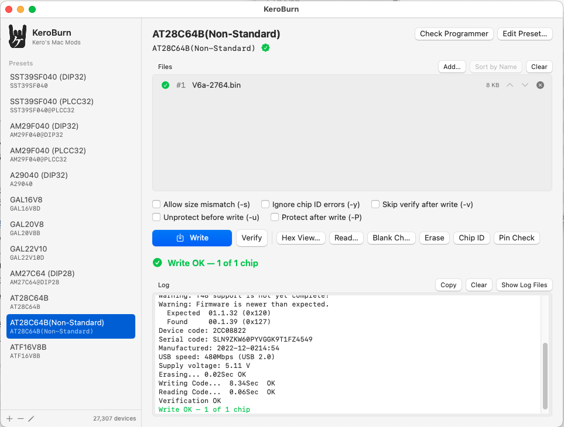
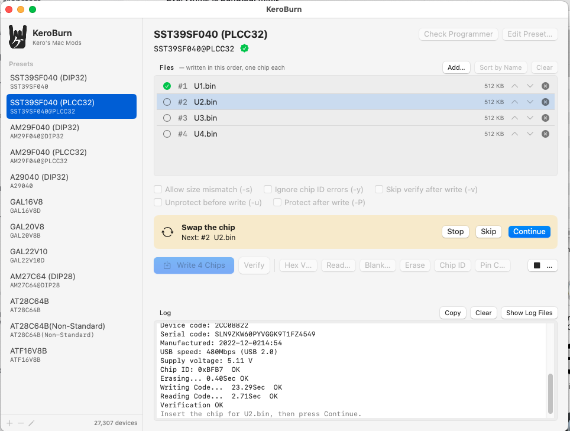
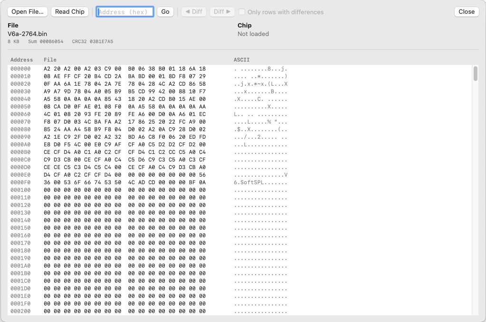
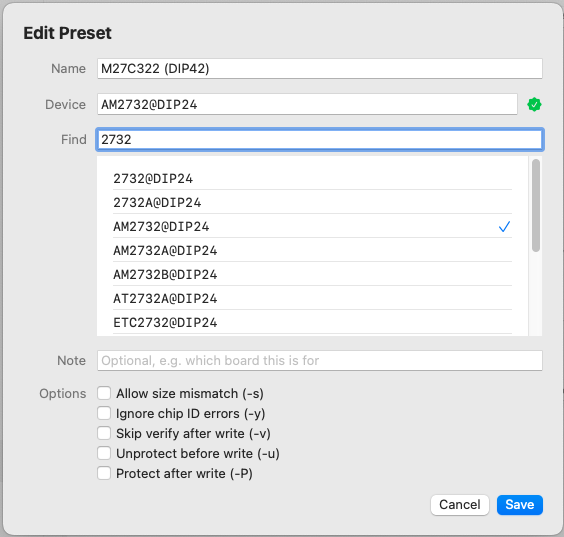

# KeroBurn

A Mac front end for [minipro](https://gitlab.com/DavidGriffith/minipro), the open source driver for XGecu chip programmers (T48, T56, TL866II+, TL866A/CS). Pick a chip, drop a file on the window, hit Write. No Windows box, no typing device names into Terminal.

I wrote it because I burn the same handful of parts over and over (SST39SF040, AM29F040, AT28C64B, GAL16V8/20V8/22V10) and got tired of looking up the exact minipro spelling every time.



minipro, libusb and the device database are bundled inside the app, so you don't need Homebrew or MacPorts to run it. Universal binary, runs natively on Intel and Apple Silicon. macOS 12 or later.

## Install

Open `KeroBurn-1.0.dmg` and drag KeroBurn into Applications.

The app is only ad hoc signed, not notarized. The first time, right-click it and choose Open, then Open again in the dialog. After that it opens normally.

## Using it

1. Pick a preset on the left.
2. Drop a `.bin` (or `.jed` for GALs) on the Files area.
3. Write (⌘↩).

Drop more than one file and they get written in order, one chip each. After every chip a yellow bar asks you to swap in the next one, press Return to continue. That's how I do ROM HI/LO pairs and 4-chip ROM SIMM sets. Files sort by name when you drop them, so `_HI` comes before `_LO` and `_0` before `_3`. Use the arrows if you want a different order.



## Hex View



This is the part I use most. Hex View loads the file, reads the chip in the socket, and puts them side by side with every byte that doesn't match in red. Use the Diff arrows to jump between mismatches, or tick "Only rows with differences".

It also tries to tell you what went wrong:

- if the file's data turns up in the chip at a different address, it reports the shift (handy when an image was built for the wrong base address)
- if every mismatch is on even or odd addresses only, it says so, because that's usually a HI/LO mix-up
- if the chip reads back as all FF, it says the chip looks blank

Sum and CRC32 are shown for both the file and the chip. Nothing is editable yet, it's a viewer. For GALs it shows the .jed as text, so a file vs chip compare there will flag header differences too. Use Verify for PLDs.

The other buttons are straight minipro options:

| Button | minipro |
|---|---|
| Verify | `-m` |
| Read… | `-r` |
| Blank Check | `-b` |
| Erase | `-E` |
| Chip ID | `-D` |
| Pin Check | `-z` |
| Check Programmer | `-k` |

The checkboxes are saved per preset:

- Allow size mismatch (`-s`)
- Ignore chip ID errors (`-y`)
- Skip verify after write (`-v`)
- Unprotect before write (`-u`), for EEPROMs with software data protection
- Protect after write (`-P`)

## Presets

Add one with the + button, or right-click an existing one and Duplicate. In the editor, type part of a name like `2732` or `2764` and pick from the list. The list comes from the T48 / TL866II+ section of minipro's database, so a name with a green check is one your programmer will accept. An orange triangle means minipro doesn't know that name.

Watch out, some parts are named differently for the T48 than for the old TL866A. A29040 in PLCC32 is `A29040L@PLCC32` on the T48, for example.



Presets live in `~/Library/Application Support/KeroBurn/presets.json`. You can edit it by hand and reload it from Settings.

## Logs

Every job gets one line in `~/Library/Logs/KeroBurn/KeroBurn-YYYY-MM.log`: time, preset, file name, size and the first 16 hex digits of the file's SHA-256. Failures also get the last few lines of minipro output. I use it to check which ROM image went into which order.

## Known issues

**AT28C64B fails verify at address 0x0001.** Only the first and last byte of every 64-byte page get written. It's the T48 page-write timing, not a bad chip. Use `AT28C64B(Non-Standard)` instead, which writes one byte at a time. Slower (about 8 seconds for 8KB) but it verifies.

**Firmware warnings.** minipro 0.7.4 was written against T48 firmware 0x120 and complains if yours is older or newer. My T48 shipped with 00.1.07 and most things still worked. After updating it with Xgpro on Windows it reports 00.1.39 ("newer than expected") and everything I've tried works fine. If a chip misbehaves on old firmware, update it first.

**Apple Silicon is untested on real hardware.** It builds and both slices are in the app, I just don't own an M-series Mac. If you try it, let me know.

## Building from source

You need the Xcode Command Line Tools and MacPorts. Homebrew no longer installs on Intel Macs, so MacPorts it is.

```
xcode-select --install
sudo port install minipro
sudo port upgrade --enforce-variants minipro +universal   # only for a universal build
PATH=/opt/local/bin:$PATH bash build.sh
```

`build.sh` compiles both architectures, rebuilds minipro from source as a universal binary if the MacPorts one is single-arch, copies minipro, its dylibs and the XML database into the app, signs it ad hoc, and makes the .dmg. Output goes to `build/`.

Options:

- `ARCHS="x86_64" bash build.sh` builds Intel only (much faster)
- `NO_DMG=1 bash build.sh` skips the disk image

If the Swift compile hangs for ages and the log is full of `module.modulemap` lines with `redefinition of module 'SwiftBridging'`, your Command Line Tools install has a leftover file from an older version. Move it out of the way and rebuild:

```
sudo mv /Library/Developer/CommandLineTools/usr/include/swift/module.modulemap \
        /Library/Developer/CommandLineTools/usr/include/swift/module.modulemap.bak
```

## License

minipro is GPLv3, and since it ships inside the app, KeroBurn is GPLv3 too.

Kay Koba, Kero's Mac Mods / Infinity Products
